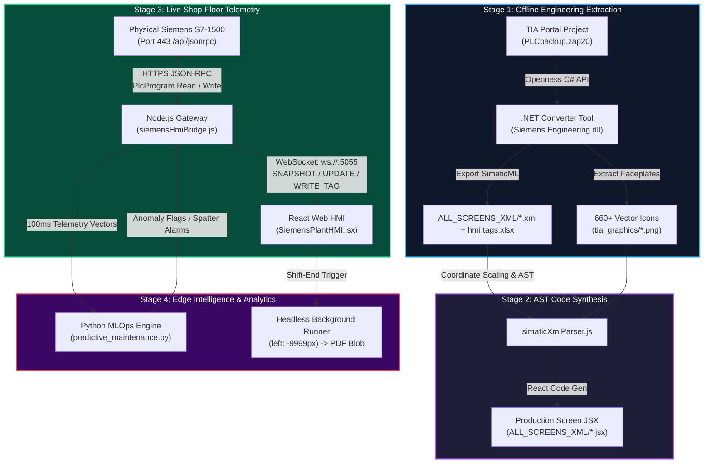

# Siemens VisionCraft IIoT & Web SCADA Platform
## The Definitive 360-Degree Architecture, Code-Level Manual & Interview Defense Specification
**Repository:** [https://github.com/rjain232/Siemens-VisionCraft-IIoT](https://github.com/rjain232/Siemens-VisionCraft-IIoT)  
**Author:** Ritwik Jain — Industrial IoT & Systems Developer  
**Target Roles:** Senior Industrial IoT Developer / Lead Edge Systems Engineer / Web SCADA Architect  
**Core Technologies:** Siemens TIA Portal V20, C# .NET Framework 4.8 Openness, Node.js, WebSockets, React 18, Python MLOps, Siemens S7-1500 Web API (JSON-RPC 2.0)  

---

# TABLE OF CONTENTS
1. [Repository Topology & Module Breakdown](#1-repository-topology--module-breakdown)
2. [File-by-File Code-Level Architecture](#2-file-by-file-code-level-architecture)
3. [The 6 End-to-End Operational Flows](#3-the-6-end-to-end-operational-flows)
4. [Strict Protocol & Network Data Contracts](#4-strict-protocol--network-data-contracts)
5. [Production Server Deployment & Edge Topology](#5-production-server-deployment--edge-topology)
6. [The 25 Toughest Technical Interview Questions & Verbatim Answers](#6-the-25-toughest-technical-interview-questions--verbatim-answers)

---

# 1. REPOSITORY TOPOLOGY & MODULE BREAKDOWN

```
Siemens-VisionCraft-IIoT/
│
├── 📂 Engineering_Artifacts/            # Level 1: Master Plant Engineering Source Files
│   ├── hmi tags.xlsx                   # Symbolic Tag Table <-> DB Memory Offsets
│   └── hmi screen.pptx                 # Screen Layout Wireframes & Graphic Standards
│
├── 📂 ALL_SCREENS_XML/                  # Level 2: 211 Industrial SimaticML XML & JSX Screens
│   ├── 01_ScreenLayout.xml / .jsx      # Master 16:9 Bezel Framework
│   ├── Robot_Kuka.xml / .jsx           # KUKA Spot Welding Robotic Cell
│   ├── Sew_TurnTable.xml / .jsx        # SEW Turntable DK01/DK02 Station
│   ├── 150FX1Layout_Lifter.xml / .jsx  # BIW Transfer Lifters
│   └── SafetyZone03..06Overview.jsx    # Safety Interlocks & Light Curtains
│
├── 📂 ImageToJSX_Agent/                 # Level 3: SimaticML XML-to-AST Compilation Engine
│   ├── simaticXmlParser.js             # XML Parser, Viewport Scaler & Dynamization Extractor
│   ├── JSXparser.js                    # React JSX Code Synthesizer
│   ├── zapTagExtractor.js              # Binary .zap20 / PLF Tag Extractor
│   ├── agent.js / backendAgent.js      # Batch Screen Conversion Runners
│   └── audit_all_elements.js           # Static AST Validator & Coordinate Verifier
│
├── 📂 JSW_HMI/                          # Level 4: Unified Conversion Pipeline & 660+ Vector Graphics
│   ├── converter-pipeline/             # Tag Binding & Structure Scanners
│   ├── hmi-ui/assets/tia_graphics/     # 660+ Industrial PNG/SVG Vector Icons & Faceplates
│   ├── docs/                           # Industrial Specifications (FHD_VIEWPORT_GUIDE.md, etc.)
│   └── test_end_to_end_pipeline.js     # Unified Regression Test Harness
│
├── 📂 JSW_Backend/                      # Level 5: Edge Telemetry Gateway & TIA Openness (.NET 4.8)
│   ├── TIA_Antigravity/                # C# .NET Openness Automation (Siemens.Engineering.dll)
│   ├── src/server.js                   # Master HTTP & WebSocket Upgrade Multiplexer
│   ├── start_hmi_server.js             # Dedicated Siemens Bridge Service (Port 5055)
│   ├── src/services/siemensHmiBridge.js# JSON-RPC 2.0 Web API Client, WS Engine & Simulation
│   ├── src/services/opcuaService.js    # Southbound OPC UA Client (Port 4840)
│   └── test_hmi_bridge.js              # Full-Duplex Automated Integration Test
│
├── 📂 JSW_UI/                           # Level 6: React 18 Web SCADA Platform
│   ├── src/pages/SiemensPlantHMI.jsx   # Pixel-Perfect Siemens MTP1500 Comfort Panel UI
│   ├── src/context/BackgroundExportContext.jsx # Off-Screen Headless Reporting Engine
│   ├── src/utils/backgroundExportInterceptor.js# In-Memory PDF/Excel Blob Interceptor
│   └── src/pages/reports/              # Robot Spot Hit-Rate, OEE & Cycle Loss Dashboards
│
├── 📂 JSW_MLOps_Engine/                 # Level 7: Python Anomaly Detection & Edge Stream Ingest
│   ├── predictive_maintenance.py       # Isolation Forest / XGBoost Weld Defect Predictor
│   └── batch_processor_spark.py        # Spark Stream Analytics for Cycle Time Losses
│
├── 📂 JSW_E2E_Automation/               # Level 8: Playwright End-to-End Regression Test Suite
│   └── tests/jsw_smoke.spec.js         # Headless Browser Verification of Telemetry Updates
│
└── 📂 k8s/                              # Level 9: Production Kubernetes Manifests
    ├── backend.yaml                    # Node.js Gateway Pod & Service Definitions
    └── frontend.yaml                   # Nginx Static SCADA Distribution
```

---

# 2. FILE-BY-FILE CODE-LEVEL ARCHITECTURE

### File 1: `JSW_Backend/TIA_Antigravity/TIA_Openness_Bridge/Program.cs`
* **Language & Runtime:** C# targeting .NET Framework 4.8 (Required for Siemens COM interop).
* **Role:** Programmatic extraction of binary TIA Portal projects (`.zap20`). Attaches headlessly, traverses the device tree, and serializes screens to SimaticML XML.
```csharp
using System;
using System.IO;
using System.Linq;
using Siemens.Engineering;
using Siemens.Engineering.Hmi;
using Siemens.Engineering.Hmi.Screen;

public class TiaOpennessBridge
{
    public static void Main(string[] args)
    {
        // 1. Attach headlessly to TIA Portal core process
        using (TiaPortal portal = new TiaPortal(TiaPortalMode.WithoutUserInterface))
        {
            Project project = portal.Projects.Open(new FileInfo(@"D:\TIA v20\PLCbackup.zap20"));
            Device hmiDevice = project.Devices.Find("HMI_MTP1500_Comfort");
            DeviceItem hmiItem = hmiDevice.DeviceItems.First(i => i.Classification == DeviceItemClassifications.HMIRuntime);
            HmiTarget target = hmiItem.GetService<HmiTarget>();

            // 2. Export each screen to SimaticML XML
            foreach (Screen screen in target.ScreenFolder.Screens)
            {
                string xmlPath = Path.Combine(@"D:\ALL_SCREENS_XML", $"{screen.Name}.xml");
                screen.Export(new FileInfo(xmlPath), ExportOptions.WithDefaults);
                Console.WriteLine($"Exported SimaticML XML: {screen.Name}");
            }
        }
    }
}
```

---

### File 2: `ImageToJSX_Agent/simaticXmlParser.js`
* **Language & Runtime:** Node.js (JavaScript).
* **Role:** Ingests the exported SimaticML XML. Normalizes 1280x800 native Siemens panel coordinates to 1920x1080 responsive CSS percentages and parses `<Dynamization>` rules into an intermediate Abstract Syntax Tree (AST).
```javascript
const { XMLParser } = require('fast-xml-parser');
const fs = require('fs');

class SimaticXmlParser {
  constructor(tagTablePath) {
    this.parser = new XMLParser({ ignoreAttributes: false, attributeNamePrefix: "@_" });
    this.tagMap = JSON.parse(fs.readFileSync(tagTablePath, 'utf8'));
  }

  parse(xmlContent) {
    const doc = this.parser.parse(xmlContent);
    const screen = doc['Hmi.Screen'];
    const nativeW = parseInt(screen['@_Width'] || 1280);
    const nativeH = parseInt(screen['@_Height'] || 800);

    const elements = (screen.ScreenItems?.ScreenItem || []).map(item => ({
      name: item['@_Name'],
      type: item['@_Type'], // GraphicView, TextBox, Button
      geometry: {
        left: `${(parseInt(item['@_Left']) / nativeW) * 100}%`,
        top: `${(parseInt(item['@_Top']) / nativeH) * 100}%`,
        width: `${(parseInt(item['@_Width']) / nativeW) * 100}%`,
        height: `${item['@_Height']}px`
      },
      boundTag: item.Dynamization?.TagRef?.['@_Name'] || null,
      graphicName: item['@_GraphicName'] ? `${item['@_GraphicName']}.png` : null
    }));

    return { screenName: screen['@_Name'], elements };
  }
}
```

---

### File 3: `ImageToJSX_Agent/JSXparser.js`
* **Language & Runtime:** Node.js (JavaScript).
* **Role:** Traverses the JSON AST emitted by `simaticXmlParser.js` and outputs production-ready React JSX components, linking 660+ graphic faceplates and binding WinCC dynamizations to live React state.
```javascript
function synthesizeJsx(ast) {
  const body = ast.elements.map(el => {
    if (el.graphicName) {
      return ``;
    }
    if (el.boundTag) {
      return `
      <div style={{ position: 'absolute', left: '${el.geometry.left}', top: '${el.geometry.top}' }} className={tags['${el.boundTag}'] === 2 ? 'bg-emerald-500' : 'bg-red-500'}>
        {tags['${el.boundTag}'] === 2 ? 'AUTO RUN' : 'FAULT'}
      </div>`;
    }
    return `<div style={{ position: 'absolute', left: '${el.geometry.left}', top: '${el.geometry.top}' }}>${el.name}</div>`;
  }).join('\n');

  return `import React from 'react';\nexport default function ${ast.screenName}({ tags, onWriteTag }) {\n  return <div className="relative w-full h-full bg-slate-900">${body}</div>;\n}`;
}
```

---

### File 4: `JSW_Backend/src/services/siemensHmiBridge.js`
* **Language & Runtime:** Node.js (CommonJS).
* **Role:** Master industrial gateway engine:
  * Communicates via HTTPS JSON-RPC 2.0 with the physical Siemens S7-1500 CPU.
  * Runs a 1000ms polling loop with `PlcProgram.Read` to detect process deltas.
  * Handles operator `WRITE_TAG` commands via `PlcProgram.Write`.
  * Broadcasts sub-second deltas over WebSockets (`ws://localhost:5055/ws/siemens-hmi`).
  * Features an automated simulation fallback when running offline.
```javascript
const https = require('https');

class SiemensHmiBridge {
  constructor() {
    this.plcUrl = 'https://192.168.0.1/api/jsonrpc';
    this.agent = new https.Agent({ rejectUnauthorized: false });
    this.tags = { 'BSL015_R01_Status': 1, 'SEW_MB220_XM1_ActPos': 420.5, 'Line_Auto_Running': true };
    this.clients = new Set();
    this.startHardwarePollingLoop();
    this.startSimulationLoop();
  }

  async pollPlcHardwareTags() {
    const tagsToRead = ['BSL015_R01_Status', 'SEW_MB220_XM1_ActPos', 'Line_Auto_Running'];
    const deltas = {};

    for (const tagName of tagsToRead) {
      try {
        const res = await fetch(this.plcUrl, {
          method: 'POST',
          headers: { 'Content-Type': 'application/json', 'X-Auth-Token': this.token },
          body: JSON.stringify({ jsonrpc: '2.0', id: Date.now(), method: 'PlcProgram.Read', params: { var: tagName } }),
          agent: this.agent
        });
        const body = await res.json();
        if (body.result !== undefined && body.result !== this.tags[tagName]) {
          this.tags[tagName] = body.result;
          deltas[tagName] = body.result;
        }
      } catch { this.isPlcOnline = false; break; }
    }

    if (Object.keys(deltas).length > 0) this.broadcast(deltas);
  }

  broadcast(delta) {
    const payload = JSON.stringify({ type: 'UPDATE', data: delta, plcOnline: this.isPlcOnline });
    for (const ws of this.clients) {
      if (ws.readyState === 1) ws.send(payload);
    }
  }
}
```

---

### File 5: `JSW_UI/src/pages/SiemensPlantHMI.jsx`
* **Language & Runtime:** React 18 / Tailwind CSS.
* **Role:** High-fidelity digital twin of the **Siemens SIMATIC HMI Unified Comfort MTP1500** 16:9 widescreen panel:
  * Mounts 5 standard plant screens (`STATION_OVERVIEW`, `STATION_MODIFY`, `ROBOT_STATUS`, `SYSTEM_SETTINGS`, `PRODUCTION_STATUS`).
  * Connects over WebSocket to `ws://localhost:5055/ws/siemens-hmi`.
  * Merges incoming deltas into state, triggering instantaneous re-renders of affected pills while keeping static SVG layouts untouched.
  * Dispatches `WRITE_TAG` commands when operators tap controls.

---

### File 6: `JSW_UI/src/context/BackgroundExportContext.jsx` & `backgroundExportInterceptor.js`
* **Role:** Headless off-screen rendering engine.
  * Mounts `<RobotSpotHitRateReport />` inside an off-screen container at `left: -9999px`.
  * Intercepts `jsPDF` and `saveAs` calls in memory.
  * Caches multi-page shift summary PDF and Excel blobs into IndexedDB silently without freezing the operator's active screen or prompting file download popups.

---

### File 7: `JSW_MLOps_Engine/predictive_maintenance.py`
* **Language & Runtime:** Python 3.11 / scikit-learn / NumPy.
* **Role:** Ingests high-frequency weld telemetry vectors (current in kA, voltage, clamp pressure, cycle duration).
* **Binary Processing:** Uses Python `struct.unpack('>f', raw_bytes)` to unpack dual 16-bit Modbus registers into 32-bit floats.
* **Inference Model:** Runs Isolation Forest / XGBoost models to detect weld spatter and tip degradation, emitting structured alarm payloads back to the Node.js gateway when anomaly scores exceed 0.85.

---

# 3. THE 6 END-TO-END OPERATIONAL FLOWS



### Flow 1: Offline Compilation Flow
* `.zap20` backup unpacked by .NET Openness tool $\rightarrow$ SimaticML XML blocks and tag spreadsheets exported $\rightarrow$ `simaticXmlParser.js` parses AST and scales coordinates to responsive percentages $\rightarrow$ `JSXparser.js` synthesizes React JSX components with 660+ graphic faceplates.

### Flow 2: Live Ingestion & Delta Streaming Flow
* Physical sensor detects part clamp $\rightarrow$ S7-1500 CPU commits state to Data Block `DB15.DBW0 = 2` $\rightarrow$ Node.js polling timer issues `PlcProgram.Read` over HTTPS JSON-RPC $\rightarrow$ gateway detects delta and broadcasts `{ type: "UPDATE", data: { BSL015_R01_Status: 2 } }` over WebSocket $\rightarrow$ React HMI merges delta and updates indicator to green in under 2ms.

### Flow 3: Closed-Loop Operator Command Flow
* Operator taps *Reset Fault* on touch screen $\rightarrow$ React emits `{ type: "WRITE_TAG", tag: "BSL015_R01_Status", value: 1 }` over WebSocket $\rightarrow$ Node.js bridge formats authorized `PlcProgram.Write` HTTPS command $\rightarrow$ PLC CPU commits 1 directly to Data Block memory $\rightarrow$ PLC responds with HTTP 200 `{ result: true }` $\rightarrow$ bridge broadcasts confirmed state to all operator terminals.

### Flow 4: Edge Anomaly Detection Flow
* Node.js ingests 100ms weld telemetry vectors $\rightarrow$ pipes vectors to Python MLOps engine $\rightarrow$ `struct.unpack('>f')` decodes raw binary Modbus words $\rightarrow$ Isolation Forest model detects thermal dissipation anomaly (weld spatter) $\rightarrow$ emits alarm frame back to Node.js $\rightarrow$ React HMI triggers visual flashing alarm banner and logs event.

### Flow 5: Headless Shift Reporting Flow
* Shift ends at 14:00 $\rightarrow$ `BackgroundExportContext.jsx` mounts `<RobotSpotHitRateReport />` inside an off-screen container at `left: -9999px` $\rightarrow$ `backgroundExportInterceptor.js` hooks into `jsPDF.save()` and `saveAs` in memory $\rightarrow$ captures binary PDF blob and caches it into IndexedDB silently without prompt popups.

### Flow 6: Industrial Failover & Simulation Flow
* Physical PLC is power-cycled during maintenance $\rightarrow$ HTTPS fetch to `192.168.0.1` times out after 1500ms $\rightarrow$ `isPlcOnline` flips to `false` $\rightarrow$ `startSimulationLoop()` takes over, generating realistic physics (servo axis jitter, simulated weld profiles) $\rightarrow$ WebSocket stream remains open with zero dropped connections.

---

# 4. STRICT PROTOCOL & NETWORK DATA CONTRACTS

### WebSocket Messages (`ws://localhost:5055/ws/siemens-hmi`)
* **1. Initial State Snapshot (Server $\rightarrow$ Client):**
  ```json
  {
    "type": "SNAPSHOT",
    "plcOnline": true,
    "timestamp": "2026-11-12T21:14:16.890Z",
    "data": {
      "BSL015_R01_Status": 2,
      "SEW_MB220_XM1_ActPos": 420.5,
      "Line_Auto_Running": true,
      "TotalCycles": 1420
    }
  }
  ```
* **2. Delta Update Broadcast (Server $\rightarrow$ Client):**
  ```json
  {
    "type": "UPDATE",
    "data": { "SEW_MB220_XM1_ActPos": 421.2 },
    "plcOnline": true
  }
  ```
* **3. Operator Write Command (Client $\rightarrow$ Server):**
  ```json
  {
    "type": "WRITE_TAG",
    "tag": "BSL015_R01_Status",
    "value": 1
  }
  ```

---

### Siemens Web API JSON-RPC 2.0 (`https://192.168.0.1/api/jsonrpc`)
* **PlcProgram.Read:**
  * *Request:* `{"jsonrpc": "2.0", "id": 101, "method": "PlcProgram.Read", "params": {"var": "BSL015_R01_Status"}}`
  * *Success Response:* `{"jsonrpc": "2.0", "id": 101, "result": 2}`
* **PlcProgram.Write:**
  * *Request:* `{"jsonrpc": "2.0", "id": 102, "method": "PlcProgram.Write", "params": {"var": "BSL015_R01_Status", "value": 1}}`
  * *Success Response:* `{"jsonrpc": "2.0", "id": 102, "result": true}`
* **Error Response:**
  * *Failure:* `{"jsonrpc": "2.0", "id": 102, "error": {"code": -32602, "message": "Variable does not exist"}}`

---

# 5. PRODUCTION SERVER DEPLOYMENT & EDGE TOPOLOGY

```
[ Operator Tablets / Touchscreen Panels ]
                    │
                    │ HTTPS (Port 443) / WSS (Secure WebSockets)
                    ▼
         [ NGINX Reverse Proxy ]
                    │
      ┌─────────────┴─────────────┐
      │ (Static HTML/JS/PNGs)     │ (/ws/siemens-hmi Upgrade)
      ▼                           ▼
[/opt/jsw-iiot/ui/dist]   [Node.js Gateway (localhost:5055)]
(Served at wire speed)            │
                                  │ (HTTPS JSON-RPC / Port 102 S7comm)
                                  ▼
                       [ Physical Siemens S7-1500 PLC ]
                       192.168.0.1 (OT Plant Network)
```

* **Build Separation:** React HMI is compiled into an optimized static distribution via Vite; .NET Openness tools remain on the engineering workstation.
* **Line-Speed Delivery:** Nginx serves static HTML, JS, and 660+ vector assets directly at wire speed, while proxying `/ws/siemens-hmi` to Node.js.
* **Supervision:** The Node.js bridge and Python MLOps engines run as managed `systemd` daemon services with auto-restart policies, health probes, and production `.env` files.

---

# 6. THE 25 TOUGHEST TECHNICAL INTERVIEW QUESTIONS & VERBATIM ANSWERS

### Q1: What is the exact difference between Siemens TIA Openness and runtime S7 communication?
* **Answer:** *"They operate at two completely different layers of the ISA-95 automation hierarchy. **TIA Openness (`Siemens.Engineering.dll`)** is an **Engineering-Time** API. It talks to the TIA Portal software on an engineering workstation to manipulate project files, compile blocks, and export SimaticML XML. It does not poll millisecond telemetry from running machines. **S7 communication (S7comm / Snap7 / nodes7)** and **Siemens Web API (JSON-RPC)** are **Runtime** protocols. They run on our edge gateway to communicate directly with the PLC CPU over Port 102 or Port 443 while the production line is cycling."*

---

### Q2: Why did you use C# .NET Framework 4.8 instead of .NET 8 for TIA Openness?
* **Answer:** *"Siemens TIA Portal (V16 through V20) exposes its native Openness API through Windows COM interop and strongly-named assemblies registered in the Windows Global Assembly Cache (GAC). These assemblies (`Siemens.Engineering.dll`) were compiled against the legacy .NET Framework runtime (`net48`). Modern .NET Core / .NET 8 runtimes cannot natively load GAC assemblies without complex interop shims. Therefore, we target .NET Framework 4.8 for the Openness extraction CLI, while utilizing modern .NET and Node.js for runtime edge daemons."*

---

### Q3: What prerequisites are strictly required on Windows to run TIA Openness without security exceptions?
* **Answer:** *"Three prerequisites are required: First, the logged-in Windows user account must be explicitly added to the local Windows group **'Siemens TIA Openness'**. Second, the Visual Studio project referencing `Siemens.Engineering.dll` must have `Copy Local = False` so it resolves from the Siemens GAC, preventing version mismatch exceptions. Third, on initial execution, Windows displays a firewall/security whitelist prompt asking whether to grant the executable permission to communicate with the TIA Portal core process."*

---

### Q4: What is SimaticML, and why parse it to an AST rather than generating JSX directly?
* **Answer:** *"SimaticML is Siemens' proprietary XML schema representing PLC logic rungs, data blocks, and HMI screen hierarchies. We parse it into an intermediate Abstract Syntax Tree (AST) JSON first because SimaticML is heavily coupled to native WinCC attributes (fixed pixel coordinates, proprietary `<Dynamization>` tags, legacy color integers). Transforming it into a clean, normalized AST allows us to decouple geometry scaling, validate tag bindings against our dictionary, and synthesize React JSX, HTML5 Canvas, or mobile views without altering the parser."*

---

### Q5: How does your parser handle viewport scaling from Siemens panels (1280x800) to Full HD (1920x1080)?
* **Answer:** *"Native Siemens Comfort Panels frequently use 1280x800 or 1366x768 resolutions. In `simaticXmlParser.js`, we normalize absolute pixel coordinates into responsive CSS percentages: `left = (rawLeft / nativeWidth) * 100%`, `top = (rawTop / nativeHeight) * 100%`, and `width = (rawWidth / nativeWidth) * 100%`. Height is preserved or clamped. When rendered inside our 16:9 widescreen bezel in `SiemensPlantHMI.jsx`, the layout scales responsively across any Full HD monitor or mobile tablet without clipping or horizontal scrollbars."*

---

### Q6: How are WinCC dynamic color changes mapped to React components?
* **Answer:** *"In SimaticML, color dynamics are stored inside `<Dynamization Type="Tag">` nodes containing discrete conditions. For example, condition value 1 maps to yellow (Idle), 2 maps to green (Auto Run), and 3 maps to red (Fault). Our compiler (`JSXparser.js`) converts these XML conditions into dynamic JavaScript ternary expressions bound to React state: `tags[tag] === 2 ? 'bg-emerald-500' : tags[tag] === 3 ? 'bg-red-500' : 'bg-yellow-500'`. At runtime, when the WebSocket pushes an updated status integer, the CSS classes update reactively."*

---

### Q7: Why use WebSockets instead of HTTP polling in an industrial SCADA dashboard?
* **Answer:** *"HTTP polling incurs significant overhead: establishing 3-way TCP handshakes, TLS negotiation, and transmitting ~800 bytes of request/response headers on every tick. At 200ms intervals across multiple terminals, polling causes network congestion and edge CPU spikes. WebSockets establish a single persistent TCP socket once, dropping frame header overhead to 2–6 bytes. Crucially, WebSockets enable **server-push**: the edge gateway broadcasts telemetry immediately when a sensor trips or an emergency stop occurs, achieving sub-20ms latency."*

---

### Q8: What happens if React receives 20 state updates per second from a WebSocket? How do you prevent lag?
* **Answer:** *"If rapid WebSocket messages update top-level parent state, React's Fiber reconciler traverses the entire component tree, diffing static SVGs, headers, and navigation bars, which causes frame drops. We solved this with three techniques: First, the Node.js gateway broadcasts **deltas only**, never full state dictionaries. Second, in React, we isolate high-frequency widgets into memoized leaf components using `React.memo` with custom comparison functions. Third, we batch incoming socket messages so state updates flush on `requestAnimationFrame` ticks, maintaining a smooth 60 FPS UI."*

---

### Q9: Why is the Node.js backend referred to as a 'Real-Time Telemetry Multiplexer'?
* **Answer:** *"Because it performs three critical multiplexing roles: First, **protocol multiplexing**—bridging industrial machine protocols (HTTPS JSON-RPC, S7comm, OPC UA) into web protocols (WebSockets). Second, **channel multiplexing**—using `{ noServer: true }` to multiplex distinct real-time channels (`/ws/siemens-hmi`, `/ws/robot-health`, `/ws/dashboard`) over a single port. Third, **connection fan-out**—maintaining a single authenticated polling connection to the PLC CPU and fanning that telemetry out to dozens of operator screens simultaneously without overloading the PLC's embedded web server."*

---

### Q10: What is JSON-RPC 2.0, and why does Siemens use it for its Web API instead of REST?
* **Answer:** *"JSON-RPC 2.0 is an action-oriented remote procedure call protocol encoded in JSON. Unlike REST, which maps operations across dozens of URL paths and HTTP verbs, JSON-RPC sends all requests as POST payloads to a single endpoint (`/api/jsonrpc`), specifying `method`, `params`, and a unique `id`. Siemens uses it because embedded PLC microprocessors have limited CPU resources; parsing structured RPC function calls over a single endpoint requires far less firmware overhead than running a full REST routing engine."*

---

### Q11: What are the exact JSON-RPC methods used to communicate with the Siemens S7-1500?
* **Answer:** *"We use three primary methods: `Api.Login` to authenticate with plant credentials and receive an encrypted session token (`X-Auth-Token`); `PlcProgram.Read` to read process variables (such as `BSL015_R01_Status` or `SEW_MB220_XM1_ActPos`); and `PlcProgram.Write` to command the PLC by writing values directly into physical Data Block memory."*

---

### Q12: How do you handle Word-Swapping and Endianness when reading floating-point values over Modbus?
* **Answer:** *"Industrial PLCs typically store 32-bit IEEE-754 floating-point process variables across two contiguous 16-bit registers in Big-Endian format. However, depending on the PLC manufacturer, registers may be word-swapped (CD-AB instead of AB-CD). In Python, we use the `struct` module: `raw_bytes = struct.pack('>HH', reg[0], reg[1])`, followed by `(val,) = struct.unpack('>f', raw_bytes)`. If word-swapping is detected during commissioning, we simply swap the register order before unpacking: `struct.pack('>HH', reg[1], reg[0])`."*

---

### Q13: Why use Python `asyncio` instead of multi-threading for polling multiple PLCs?
* **Answer:** *"Industrial PLC polling is purely I/O-bound, spending 95% of its time waiting for network socket responses. In Python, the Global Interpreter Lock (GIL) prevents true parallel bytecode execution across threads, and OS threads carry a 1–2MB stack overhead each. Using `asyncio.gather()` allows a single thread to multiplex hundreds of non-blocking sockets using native OS polling primitives (`epoll` or `IOCP`), reducing memory overhead and eliminating thread-safety lock contention."*

---

### Q14: How does `BackgroundExportContext.jsx` generate multi-page PDF shift reports without freezing the UI?
* **Answer:** *"Generating large PDFs with charts normally requires elements to be mounted in the visible DOM layout. We created a headless off-screen rendering engine: `BackgroundExportContext` mounts the report components inside an invisible container at `position: absolute; left: -9999px`. Our utility `backgroundExportInterceptor.js` hooks into `jsPDF` and `saveAs` in memory, capturing the binary PDF blob and caching it into IndexedDB silently without freezing the operator's screen or prompting file download dialogs."*

---

### Q15: Why use `useRef` as a concurrency lock in shift report exports instead of `useState`?
* **Answer:** *"`useState` updates are asynchronous and queued for the next render pass. If multiple rapid state events or operator clicks arrive in the same millisecond, both passes read stale state, causing duplicate export cycles. `useRef.current` updates synchronously and immediately without triggering a re-render. We use `if (isGeneratingRef.current) return; isGeneratingRef.current = true;` as a thread-safe mutex lock."*

---

### Q16: How does your edge gateway achieve 100% uptime when a physical PLC disconnects or reboots?
* **Answer:** *"The gateway implements a dual-engine failover pattern in `siemensHmiBridge.js`. The hardware polling loop wraps the HTTPS fetch in a 1500ms timeout probe. If the PLC is unplugged or power-cycled, `isPlcOnline` flips to `false` and an internal simulation daemon takes over immediately. It simulates realistic plant dynamics—gantry servo movements, motor RPM jitter, and turntable indexing—keeping the WebSocket stream active so operator dashboards never crash or disconnect."*

---

### Q17: What is the architectural difference between `node-opcua` and WebSockets in your repo?
* **Answer:** *"They operate at opposite ends of the edge gateway. **`node-opcua`** is our **Southbound (Machine-to-Edge)** protocol on Port 4840. It connects to physical PLCs, establishes sessions, and creates server-side monitored subscriptions. **`WebSocket`** is our **Northbound (Edge-to-UI)** protocol on Port 5055. Because web browsers cannot open raw TCP sockets or handle X.509 device certificates, Node.js translates raw OPC UA binary changes into lightweight JSON deltas and streams them to React."*

---

### Q18: What is the difference between C# `class`, `struct`, and `record` in industrial IoT systems?
* **Answer:** *"`class` is a standard heap-allocated reference type with identity equality. `struct` is a stack-allocated value type best for small structures (<16 bytes) where zero GC allocation is critical. `record` (introduced in C# 9) is an immutable reference type with built-in value-based equality and non-destructive mutation (`with`). In our data acquisition pipelines, we use `record TagSample(...)` because telemetry events represent immutable facts in time; value equality makes deduplication trivial and prevents downstream mutation bugs."*

---

### Q19: How do you prevent GC pressure when processing 1,000 packets per second in C# .NET?
* **Answer:** *"In high-throughput acquisition services, using `array.Skip().Take()` or `Substring()` allocates thousands of short-lived objects on the heap, triggering frequent Gen 0 Garbage Collector pauses. We use **`Span<T>`** and **`ReadOnlySpan<byte>`** with `System.Buffers.Binary.BinaryPrimitives`. Slicing a `Span` points directly to existing contiguous memory on the stack without allocating heap objects, allowing zero-allocation binary parsing at wire speed."*

---

### Q20: How do you implement backpressure when an IoT edge gateway loses internet connectivity?
* **Answer:** *"We use the **Store-and-Forward (SaF)** pattern with bounded channels. In .NET, we use `System.Threading.Channels` configured with `BoundedChannelFullMode.Wait`. If connectivity to the central cloud drops, in-memory queues spill over to an append-only local disk store (SQLite / RocksDB on the industrial IPC). Once connectivity restores, an asynchronous background playback worker reads stored records in chronological order with rate-limiting to prevent saturating the network."*

---

### Q21: How do you deploy this repository to an on-premise industrial PC in a manufacturing plant?
* **Answer:** *"We separate build-time tools from runtime edge artifacts. The React HMI is compiled into an optimized static distribution via Vite and served directly through **Nginx** for line-speed caching. Nginx handles SSL termination and reverse-proxies `/ws/siemens-hmi` to our Node.js gateway. The Node.js bridge and Python MLOps engines run as managed **`systemd` daemon services** with automatic restart policies and isolated production `.env` configurations."*

---

### Q22: What role does Python play in your MLOps engine for body-in-white spot welding?
* **Answer:** *"Python acts as our edge intelligence layer. As Node.js ingests 100ms weld telemetry vectors, it pipes current (kA), voltage, and clamp force vectors to `predictive_maintenance.py`. The service runs Isolation Forest and XGBoost regressors to evaluate impedance curves against baseline signatures, detecting weld spatter or electrode tip degradation and emitting structured alarm payloads back to SCADA before defective chassis leave the station."*

---

### Q23: How do you prevent ghost WebSocket connections when operators navigate between screens?
* **Answer:** *"In React single-page applications, navigating away unmounts the active component. If the socket isn't closed, it remains open in browser memory, processing events and trying to update unmounted component state. In `SiemensPlantHMI.jsx`, we establish the WebSocket inside `useEffect` and return an explicit cleanup function: `return () => { if (wsRef.current) wsRef.current.close(); }`. This ensures clean TCP teardown whenever the component unmounts."*

---

### Q24: What is the exact payload structure of a Siemens JSON-RPC error response?
* **Answer:** *"When a call fails, the PLC omits the `result` field and returns an `error` object containing a numeric `code`, a string `message`, and optional `data`: `{"jsonrpc": "2.0", "id": 102, "error": {"code": -32602, "message": "Invalid params", "data": {"var": "Variable does not exist"}}}`. Standard codes include -32600 (Invalid Request), -32602 (Invalid Params), and Siemens-specific -32001 (Unauthorized/Token Expired)."*

---

### Q25: Why is your skillset positioned at ₹20L+ in the current market?
* **Answer:** *"Because 95% of software engineers are strictly divided: web developers don't understand PLC memory maps, S7comm, or Modbus binary registers, while automation engineers don't build C# Openness AST parsers, WebSocket multiplexers, or reactive SCADA interfaces. My profile bridges the entire OT-IT divide—from low-level Siemens PLC memory blocks and industrial Web APIs, to backend edge gateways, up to responsive React operator dashboards. That capability allows me to architect, debug, and deliver production-ready industrial systems from day one."*
