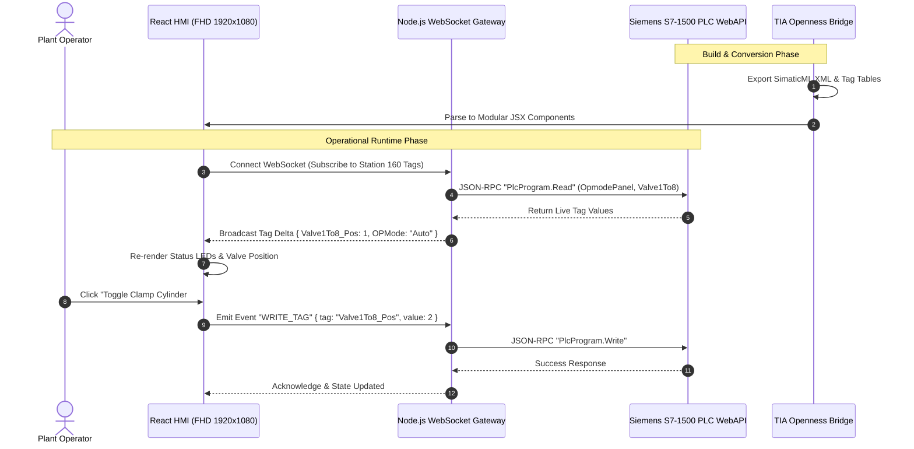

# System Architecture & Engineering Blueprint

This document details the architecture, design principles, and end-to-end data flow of the **Siemens TIA Portal V20 to Web-Based HMI System**.

---

## 1. Architectural Philosophy
Industrial control environments often rely on proprietary HMI runtimes (WinCC Advanced, WinCC Unified) that require costly per-seat licenses, vendor-locked hardware, and slow update cycles.

This system replaces that runtime with a **zero-license, open web stack**:
- **Design Source of Truth**: TIA Portal V20 (`.zap20` / `.ap20`).
- **Intermediate Format**: Open SimaticML XML + Extracted Tag Tables.
- **Conversion Engine**: Automated AST parser translating proprietary Siemens screen controls into standardized React JSX components.
- **Presentation Layer**: React 18 with CSS uniform matrix scaling for **1920 × 1080 (FHD)** displays.
- **Controller Interface**: Native Siemens S7-1500 PLC WebAPI (JSON-RPC over HTTPS) via Node.js WebSocket caching layer.

---

## 2. End-to-End Data Flow

---

## 3. Subsystem Breakdown

### 3.1. TIA Openness Bridge (`/tia-openness-bridge`)
- Built on .NET Core / C# using `Siemens.Engineering.dll` and `Siemens.Engineering.Hmi.dll`.
- Attaches to running TIA Portal instances via process discovery.
- Provides a local REST API for Antigravity AI and scripts to export screens (`IEngineeringObject.Export()`) and read tag tables.

### 3.2. Converter & AST Pipeline (`/converter-pipeline`)
- Reads SimaticML XML nodes (`HmiButton`, `HmiGraphicView`, `HmiFaceplateContainer`, `HmiRectangle`).
- Calculates coordinate transforms from the native canvas (`1276 × 673`) to standard JSX styles.
- Generates clean Tailwind / React code with state hooks for user interactions.
- Links controls to their corresponding PLC tags using `exact_faceplate_tag_bindings.json`.

### 3.3. Frontend HMI Layer (`/hmi-ui`)
- Built with React 18 and Vite.
- Wrapped in `<HMIViewport>` which monitors display resolution and scales coordinates uniformly using GPU-accelerated CSS transforms.
- Manages routing for 211 screens using standard station slugs (`/screen/160FX1Layout`, `/screen/190V23RoofGeo`).

### 3.4. Realtime Gateway Service (`/backend-service`)
- Node.js WebSocket server running on port 4000.
- Maintains an in-memory cache of the 1,148 PLC tags.
- Buffers polling to the S7-1500 WebAPI so multiple operator panels do not overload the PLC's communication processor.
- Includes a full offline mock service (`mockPlcService.js`) for rapid UI development without physical PLC hardware.
