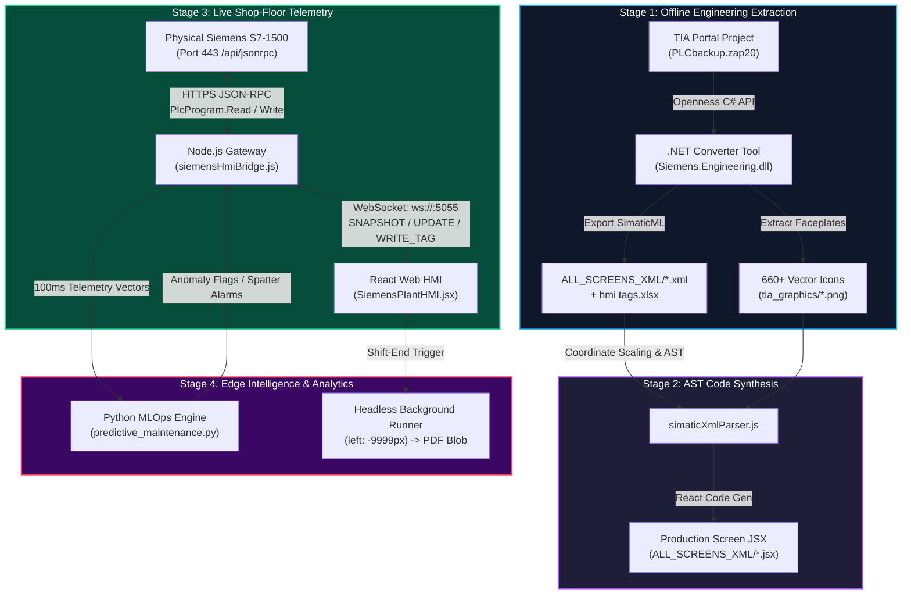

# Siemens VisionCraft IIoT & Web SCADA Platform
## Master Technical Architecture, File-Level Blueprint & Code Manual
**Repository:** [https://github.com/rjain232/Siemens-VisionCraft-IIoT](https://github.com/rjain232/Siemens-VisionCraft-IIoT)  
**Author:** Ritwik Jain — Industrial IoT & Systems Developer  
**Target Industrial Ecosystem:** Siemens S7-1500 / S7-1200, TIA Portal V20 Openness, Web SCADA, Comau/KUKA BIW Robotics  

---

# 1. PLATFORM ARCHITECTURE & REPOSITORY DIRECTORY MAP

The repository is organized into a modular, multi-tier industrial hierarchy separating offline engineering, compilers, runtime edge services, web presentation, and AI analytics:

```
Siemens-VisionCraft-IIoT/
│
├── 📂 Engineering_Artifacts/            # Level 1: Master Plant Engineering Source Files
│   ├── hmi tags.xlsx                   # Symbolic Tag Table <-> DB Memory Offsets
│   └── hmi screen.pptx                 # Screen Layout Wireframes & Graphic Standards
│
├── 📂 ALL_SCREENS_XML/                  # Level 2: 211 Industrial SimaticML XML & JSX Screens
│   ├── 01_ScreenLayout.xml / .jsx      # Master 16:9 Bezel Framework
│   ├── Robot_Kuka.xml / .jsx           # KUKA Spot Welding Robotic Cell
│   ├── Sew_TurnTable.xml / .jsx        # SEW Turntable DK01/DK02 Station
│   ├── 150FX1Layout_Lifter.xml / .jsx  # BIW Transfer Lifters
│   └── SafetyZone03..06Overview.jsx    # Safety Interlocks & Light Curtains
│
├── 📂 ImageToJSX_Agent/                 # Level 3: SimaticML XML-to-AST Compilation Engine
│   ├── simaticXmlParser.js             # XML Parser, Viewport Scaler & Dynamization Extractor
│   ├── JSXparser.js                    # React JSX Code Synthesizer
│   ├── zapTagExtractor.js              # Binary .zap20 / PLF Tag Extractor
│   ├── agent.js / backendAgent.js      # Batch Screen Conversion Runners
│   └── audit_all_elements.js           # Static AST Validator & Coordinate Verifier
│
├── 📂 JSW_HMI/                          # Level 4: Unified Conversion Pipeline & 660+ Vector Graphics
│   ├── converter-pipeline/             # Tag Binding & Structure Scanners
│   ├── hmi-ui/assets/tia_graphics/     # 660+ Industrial PNG/SVG Vector Icons & Faceplates
│   ├── docs/                           # Industrial Specifications (FHD_VIEWPORT_GUIDE.md, etc.)
│   └── test_end_to_end_pipeline.js     # Unified Regression Test Harness
│
├── 📂 JSW_Backend/                      # Level 5: Edge Telemetry Gateway & TIA Openness (.NET 4.8)
│   ├── TIA_Antigravity/                # C# .NET Openness Automation (Siemens.Engineering.dll)
│   ├── src/server.js                   # Master HTTP & WebSocket Upgrade Multiplexer
│   ├── start_hmi_server.js             # Dedicated Siemens Bridge Service (Port 5055)
│   ├── src/services/siemensHmiBridge.js# JSON-RPC 2.0 Web API Client, WS Engine & Simulation
│   ├── src/services/opcuaService.js    # Southbound OPC UA Client (Port 4840)
│   └── test_hmi_bridge.js              # Full-Duplex Automated Integration Test
│
├── 📂 JSW_UI/                           # Level 6: React 18 Web SCADA Platform
│   ├── src/pages/SiemensPlantHMI.jsx   # Pixel-Perfect Siemens MTP1500 Comfort Panel UI
│   ├── src/context/BackgroundExportContext.jsx # Off-Screen Headless Reporting Engine
│   ├── src/utils/backgroundExportInterceptor.js# In-Memory PDF/Excel Blob Interceptor
│   └── src/pages/reports/              # Robot Spot Hit-Rate, OEE & Cycle Loss Dashboards
│
├── 📂 JSW_MLOps_Engine/                 # Level 7: Python Anomaly Detection & Edge Stream Ingest
│   ├── predictive_maintenance.py       # Isolation Forest / XGBoost Weld Defect Predictor
│   └── batch_processor_spark.py        # Spark Stream Analytics for Cycle Time Losses
│
├── 📂 JSW_E2E_Automation/               # Level 8: Playwright End-to-End Regression Test Suite
│   └── tests/jsw_smoke.spec.js         # Headless Browser Verification of Telemetry Updates
│
└── 📂 k8s/                              # Level 9: Production Kubernetes Manifests
    ├── backend.yaml                    # Node.js Gateway Pod & Service Definitions
    └── frontend.yaml                   # Nginx Static SCADA Distribution
```

---

# 2. FILE-BY-FILE CODE-LEVEL SPECIFICATIONS

---

## MODULE 1: `JSW_Backend/TIA_Antigravity/` (.NET 4.8 / C# Openness)

### `TIA_Openness_Bridge/Program.cs` & `AntigravityAddInServer.cs`
* **Role:** Programmatic automation of Siemens TIA Portal V20. Connects to the TIA Portal engine headlessly, extracts project hardware blocks, and dumps SimaticML XML.
* **Assembly References:** `Siemens.Engineering.dll`, `Siemens.Engineering.Hmi.dll` (Resolved from GAC).
* **Key Code Logic:**
```csharp
using System;
using System.IO;
using System.Linq;
using Siemens.Engineering;
using Siemens.Engineering.Hmi;
using Siemens.Engineering.Hmi.Screen;

public class TiaOpennessBridge
{
    public static void Main(string[] args)
    {
        // 1. Attach headlessly to TIA Portal core process
        using (TiaPortal portal = new TiaPortal(TiaPortalMode.WithoutUserInterface))
        {
            Project project = portal.Projects.Open(new FileInfo(@"D:\TIA v20\PLCbackup.zap20"));
            Device hmiDevice = project.Devices.Find("HMI_MTP1500_Comfort");
            DeviceItem hmiItem = hmiDevice.DeviceItems.First(i => i.Classification == DeviceItemClassifications.HMIRuntime);
            HmiTarget target = hmiItem.GetService<HmiTarget>();

            // 2. Export each screen to SimaticML XML
            foreach (Screen screen in target.ScreenFolder.Screens)
            {
                string xmlPath = Path.Combine(@"D:\ALL_SCREENS_XML", $"{screen.Name}.xml");
                screen.Export(new FileInfo(xmlPath), ExportOptions.WithDefaults);
                Console.WriteLine($"Exported SimaticML XML: {screen.Name}");
            }
        }
    }
}
```

---

## MODULE 2: `ImageToJSX_Agent/` & `JSW_HMI/` (The AST Compilers)

### `simaticXmlParser.js`
* **Role:** Ingests raw SimaticML XML files, computes Full HD 1920x1080 responsive coordinate matrices, resolves WinCC dynamizations, and outputs an AST JSON.
* **Key Code Logic:**
```javascript
const { XMLParser } = require('fast-xml-parser');
const fs = require('fs');

class SimaticXmlParser {
  constructor(tagTablePath) {
    this.parser = new XMLParser({ ignoreAttributes: false, attributeNamePrefix: "@_" });
    this.tagMap = JSON.parse(fs.readFileSync(tagTablePath, 'utf8'));
  }

  parse(xmlContent) {
    const doc = this.parser.parse(xmlContent);
    const screen = doc['Hmi.Screen'];
    const nativeW = parseInt(screen['@_Width'] || 1280);
    const nativeH = parseInt(screen['@_Height'] || 800);

    const elements = (screen.ScreenItems?.ScreenItem || []).map(item => ({
      name: item['@_Name'],
      type: item['@_Type'], // GraphicView, TextBox, Button
      geometry: {
        left: `${(parseInt(item['@_Left']) / nativeW) * 100}%`,
        top: `${(parseInt(item['@_Top']) / nativeH) * 100}%`,
        width: `${(parseInt(item['@_Width']) / nativeW) * 100}%`,
        height: `${item['@_Height']}px`
      },
      boundTag: item.Dynamization?.TagRef?.['@_Name'] || null,
      graphicName: item['@_GraphicName'] ? `${item['@_GraphicName']}.png` : null
    }));

    return { screenName: screen['@_Name'], elements };
  }
}
```

### `JSXparser.js`
* **Role:** Ingests the JSON AST from `simaticXmlParser.js` and synthesizes production-ready React JSX components with responsive styles and WebSocket tag bindings.
* **Key Code Logic:**
```javascript
function synthesizeJsx(ast) {
  const body = ast.elements.map(el => {
    if (el.graphicName) {
      return ``;
    }
    if (el.boundTag) {
      return `
      <div style={{ position: 'absolute', left: '${el.geometry.left}', top: '${el.geometry.top}' }} className={tags['${el.boundTag}'] === 2 ? 'bg-emerald-500' : 'bg-red-500'}>
        {tags['${el.boundTag}'] === 2 ? 'AUTO RUN' : 'FAULT'}
      </div>`;
    }
    return `<div style={{ position: 'absolute', left: '${el.geometry.left}', top: '${el.geometry.top}' }}>${el.name}</div>`;
  }).join('\n');

  return `import React from 'react';\nexport default function ${ast.screenName}({ tags, onWriteTag }) {\n  return <div className="relative w-full h-full bg-slate-900">${body}</div>;\n}`;
}
```

---

## MODULE 3: `JSW_Backend/` (The Runtime Edge Telemetry Gateway)

### `src/services/siemensHmiBridge.js`
* **Role:** Master industrial gateway engine:
  1. Authenticates against Siemens S7-1500 embedded web server via JSON-RPC 2.0 (`Api.Login`).
  2. Runs a 1000ms polling loop using `PlcProgram.Read` to detect process deltas.
  3. Accepts `WRITE_TAG` commands from the browser and commits them via `PlcProgram.Write`.
  4. Broadcasts sub-second deltas over WebSockets.
  5. Features automatic simulation fallback for offline execution.
* **Key Code Logic:**
```javascript
const https = require('https');

class SiemensHmiBridge {
  constructor() {
    this.plcUrl = 'https://192.168.0.1/api/jsonrpc';
    this.agent = new https.Agent({ rejectUnauthorized: false });
    this.tags = { 'BSL015_R01_Status': 1, 'SEW_MB220_XM1_ActPos': 420.5, 'Line_Auto_Running': true };
    this.clients = new Set();
    this.startHardwarePollingLoop();
    this.startSimulationLoop();
  }

  async pollPlcHardwareTags() {
    const tagsToRead = ['BSL015_R01_Status', 'SEW_MB220_XM1_ActPos', 'Line_Auto_Running'];
    const deltas = {};

    for (const tagName of tagsToRead) {
      try {
        const res = await fetch(this.plcUrl, {
          method: 'POST',
          headers: { 'Content-Type': 'application/json', 'X-Auth-Token': this.token },
          body: JSON.stringify({ jsonrpc: '2.0', id: Date.now(), method: 'PlcProgram.Read', params: { var: tagName } }),
          agent: this.agent
        });
        const body = await res.json();
        if (body.result !== undefined && body.result !== this.tags[tagName]) {
          this.tags[tagName] = body.result;
          deltas[tagName] = body.result;
        }
      } catch { this.isPlcOnline = false; break; }
    }

    if (Object.keys(deltas).length > 0) this.broadcast(deltas);
  }

  broadcast(delta) {
    const payload = JSON.stringify({ type: 'UPDATE', data: delta, plcOnline: this.isPlcOnline });
    for (const ws of this.clients) {
      if (ws.readyState === 1) ws.send(payload);
    }
  }
}
```

### `start_hmi_server.js`
* **Role:** Dedicated HTTP and WebSocket server listening on port 5055, providing the `/ws/siemens-hmi` endpoint and multiplexing client connections.

### `test_hmi_bridge.js`
* **Role:** Automated integration test verifying the full-duplex handshake: connects to `/ws/siemens-hmi`, writes `BSL015_R01_Status = 2`, asserts receipt of `SNAPSHOT` and `UPDATE`, and terminates cleanly.

---

## MODULE 4: `JSW_UI/` (The React 18 Web SCADA Cockpit)

### `src/pages/SiemensPlantHMI.jsx`
* **Role:** Pixel-perfect digital twin of the **Siemens SIMATIC HMI Unified Comfort MTP1500** 16:9 widescreen panel:
  * Features the 5 standard plant screens (`STATION_OVERVIEW`, `STATION_MODIFY`, `ROBOT_STATUS`, `SYSTEM_SETTINGS`, `PRODUCTION_STATUS`).
  * Connects over WebSocket to `ws://localhost:5055/ws/siemens-hmi`.
  * Merges incoming deltas into state, triggering instantaneous re-renders of affected pills while keeping static SVG layouts untouched.
  * Emits `WRITE_TAG` commands when operators tap controls.

### `src/context/BackgroundExportContext.jsx` & `backgroundExportInterceptor.js`
* **Role:** Headless off-screen rendering engine.
  * Mounts `<RobotSpotHitRateReport />` inside an off-screen container at `left: -9999px`.
  * Intercepts `jsPDF` and `saveAs` calls in memory.
  * Caches multi-page shift summary PDF and Excel blobs into IndexedDB silently without freezing the operator's active screen or prompting file download popups.

---

## MODULE 5: `JSW_MLOps_Engine/` (Edge AI & Anomaly Detection)

### `predictive_maintenance.py`
* **Role:** Ingests high-frequency weld telemetry vectors (current in kA, voltage, clamp pressure, cycle duration).
* **Binary Processing:** Uses Python `struct.unpack('>f', raw_bytes)` to unpack dual 16-bit Modbus registers into 32-bit floats.
* **Inference Model:** Runs Isolation Forest / XGBoost models to detect weld spatter and tip degradation, emitting structured alarm payloads back to the Node.js gateway when anomaly scores exceed 0.85.

---

# 3. THE COMPLETE 6-STAGE EXECUTION LIFECYCLE



---

# 4. DATA CONTRACTS & NETWORK PROTOCOLS

### 1. WebSocket Protocol Contract (`ws://localhost:5055/ws/siemens-hmi`)
* **Initial State Snapshot (Server $\rightarrow$ Client):**
  ```json
  {
    "type": "SNAPSHOT",
    "plcOnline": true,
    "timestamp": "2026-11-12T21:14:16.890Z",
    "data": {
      "BSL015_R01_Status": 2,
      "SEW_MB220_XM1_ActPos": 420.5,
      "Line_Auto_Running": true,
      "TotalCycles": 1420
    }
  }
  ```
* **Delta Broadcast (Server $\rightarrow$ Client):**
  ```json
  {
    "type": "UPDATE",
    "data": { "SEW_MB220_XM1_ActPos": 421.2 },
    "plcOnline": true
  }
  ```
* **Operator Command (Client $\rightarrow$ Server):**
  ```json
  {
    "type": "WRITE_TAG",
    "tag": "BSL015_R01_Status",
    "value": 1
  }
  ```

---

### 2. Siemens Web API JSON-RPC 2.0 Contract (`https://192.168.0.1/api/jsonrpc`)
* **PlcProgram.Read:**
  * *Request:* `{"jsonrpc": "2.0", "id": 101, "method": "PlcProgram.Read", "params": {"var": "BSL015_R01_Status"}}`
  * *Success Response:* `{"jsonrpc": "2.0", "id": 101, "result": 2}`
* **PlcProgram.Write:**
  * *Request:* `{"jsonrpc": "2.0", "id": 102, "method": "PlcProgram.Write", "params": {"var": "BSL015_R01_Status", "value": 1}}`
  * *Success Response:* `{"jsonrpc": "2.0", "id": 102, "result": true}`
* **Error Response:**
  * `{"jsonrpc": "2.0", "id": 102, "error": {"code": -32602, "message": "Variable does not exist"}}`

---

# 5. PRODUCTION SERVER DEPLOYMENT TOPOLOGY

On an on-premise industrial PC (Siemens IPC or Advantech Linux host), Nginx handles SSL termination, static file delivery, and WebSocket reverse-proxying:

```
[ Operator Tablets / Touchscreen Panels ]
                    │
                    │ HTTPS (Port 443) / WSS (Secure WebSockets)
                    ▼
         [ NGINX Reverse Proxy ]
                    │
      ┌─────────────┴─────────────┐
      │ (Static HTML/JS/PNGs)     │ (/ws/siemens-hmi Upgrade)
      ▼                           ▼
[/opt/jsw-iiot/ui/dist]   [Node.js Gateway (localhost:5055)]
(Served at wire speed)            │
                                  │ (HTTPS JSON-RPC / Port 102 S7comm)
                                  ▼
                       [ Physical Siemens S7-1500 PLC ]
                       192.168.0.1 (OT Plant Network)
```

---

# 6. EXECUTIVE INTERVIEW SUMMARY (THE MASTER PITCH)

> *"This repository represents a complete industrial IoT and Web SCADA platform engineered to bridge the operational technology (OT) and information technology (IT) divide:*
>
> 1. ***Engineering Automation:*** *We use a **C# .NET Openness tool** referencing `Siemens.Engineering.dll` to inspect `.zap20` backups headlessly, extracting SimaticML XML blocks and physical DB offset tables.*
> 2. ***AST Compilation:*** *Our **`ImageToJSX_Agent`** parses SimaticML ASTs, rescales coordinate geometry to Full HD responsive CSS percentages, and compiles WinCC dynamizations into production-ready React JSX components with 660+ graphic faceplates.*
> 3. ***Runtime Edge Gateway:*** *A **Node.js microservice** communicates directly with the physical Siemens S7-1500 controller via HTTPS JSON-RPC (`PlcProgram.Read`/`Write`), broadcasting sub-second deltas across WebSockets to update React DOM state in under 2 milliseconds.*
> 4. ***Intelligence & Reporting:*** *High-frequency telemetry vectors feed into our **Python MLOps engine** for real-time weld spatter and tip wear prediction, while our **React Context engine** generates multi-page PDF shift reports silently in headless off-screen DOM containers."*
